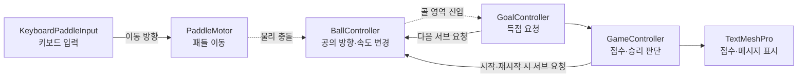

# PongGame

**Unity와 C#으로 만든 로컬 2인용 2D 탁구 게임입니다.**

두 플레이어가 하나의 키보드로 각자의 패들(공을 받아치는 막대)을 움직입니다. 공을 상대편 골에 넣으면 점수를 얻으며, 먼저 5점을 얻은 플레이어의 승리 메시지가 표시됩니다.

사용자 입력이 패들 이동, 공의 충돌, 득점, 화면 표시로 이어지는 과정을 구현한 개인 프로젝트입니다. 입력·이동·공·득점·게임 진행의 책임을 5개의 스크립트로 나누었습니다.

## 프로젝트 개요

| 항목 | 내용 |
| --- | --- |
| 개발 형태 | 개인 프로젝트 |
| 엔진 | Unity `6000.3.21f1` — 프로젝트에 기록된 버전 |
| 언어 | C# |
| 주요 기능 | 키보드 조작, 패들 이동 제한, 충돌 위치에 따른 공 반사, 득점·승리 표시, 재시작 |
| 주요 기술 | Unity 2D Physics, Coroutine, TextMeshPro, 컴포넌트 기반 역할 분리 |
| 플레이 방식 | 같은 기기와 키보드를 사용하는 로컬 2인 플레이 |
| 실행 씬 | `Assets/Scenes/SampleScene.unity` |

## 게임 규칙과 조작

| 대상 | 조작 |
| --- | --- |
| 왼쪽 패들 | `W` 위로 / `S` 아래로 |
| 오른쪽 패들 | `↑` 위로 / `↓` 아래로 |
| 재시작 | 승리 메시지가 나온 뒤 `R` |

- 공이 왼쪽 골에 들어가면 오른쪽 플레이어가 득점합니다. 오른쪽 골에 들어가면 왼쪽 플레이어가 득점합니다.
- 패들에 맞을 때마다 공의 속도가 증가하며, 설정된 최대 속도로 제한됩니다.
- 승리 점수는 현재 **5점**이며 Inspector의 `scoreToWin`에서 변경할 수 있습니다.
- 재시작하면 점수와 메시지가 초기화되고 다음 게임의 서브가 예약됩니다.

## 실행 방법

1. 저장소를 다운로드하거나 복제합니다.

   ```bash
   git clone https://github.com/JCBBBBBB/PongGame.git
   ```

2. Unity Hub에서 프로젝트를 추가합니다. `Assets`, `Packages`, `ProjectSettings` 폴더가 들어 있는 **PongGame 폴더**를 선택합니다.
3. 프로젝트에 기록된 Unity `6000.3.21f1` 버전으로 열고 패키지 가져오기가 끝날 때까지 기다립니다.
4. `Assets/Scenes/SampleScene.unity`를 열고 **Play**를 누릅니다.
5. **Game 뷰를 클릭**한 뒤 키보드로 조작합니다.

현재 입력 코드는 `Input.GetKey`와 `Input.GetKeyDown`을 사용합니다. 프로젝트의 **Active Input Handling**은 `Both`로 저장되어 있습니다.

## 코드 구조

핵심 게임 로직은 `Assets/Scripts`의 다음 5개 파일에 있습니다.

| 스크립트 | 담당 역할 |
| --- | --- |
| [KeyboardPaddleInput.cs](Assets/Scripts/KeyboardPaddleInput.cs) | 키보드 입력을 읽고 패들에 이동 방향 전달 |
| [PaddleMotor.cs](Assets/Scripts/PaddleMotor.cs) | 전달받은 방향으로 패들 이동, 패들 크기를 고려한 이동 범위 제한 |
| [BallController.cs](Assets/Scripts/BallController.cs) | 공 발사·정지, 패들 충돌 시 방향·속도 계산, 득점 후 재서브 |
| [GoalController.cs](Assets/Scripts/GoalController.cs) | 공의 골 진입 감지, 상대편 득점 요청, 다음 서브 요청 |
| [GameController.cs](Assets/Scripts/GameController.cs) | 게임 상태와 점수 관리, 승리 조건 판단, 점수·메시지 UI 갱신, 재시작 |

### 입력부터 화면 반영까지



실선은 스크립트 사이의 요청, 점선은 Unity의 물리 이벤트를 나타냅니다.

## 주요 구현 내용

### 1. 입력과 이동의 책임 분리

`KeyboardPaddleInput`은 어떤 키가 눌렸는지 확인하고, `PaddleMotor`는 전달받은 값으로 패들을 움직입니다. 입력을 읽는 코드와 실제 이동 계산을 분리한 구조입니다.

- `Update()`에서 입력 방향을 읽어 `SetMoveInput()`으로 전달합니다.
- `FixedUpdate()`에서 이동 위치를 계산하고 `Rigidbody2D.MovePosition()`을 호출합니다.
- 같은 스크립트를 양쪽 패들에 붙이고 Inspector에서 조작 키를 다르게 지정했습니다.

객체지향 관점에서 각 컴포넌트의 책임을 구분하고, 입력 컴포넌트가 이동 컴포넌트를 참조해 함께 동작하도록 구성했습니다. 이동 코드는 개별 키를 직접 확인하지 않습니다.

### 2. 패들의 크기를 고려한 이동 제한

패들의 중심 좌표만 제한하면 끝부분이 정해진 이동 범위를 벗어날 수 있습니다. 이를 고려해 `BoxCollider2D`에서 패들 높이의 절반을 구하고, 그만큼 이동 가능한 중심 좌표의 범위를 줄였습니다.

```csharp
// Awake에서 패들 높이의 절반을 저장합니다.
HalfHeight = boxCollider.bounds.extents.y;

// FixedUpdate에서 다음 위치를 제한합니다.
nextPosition.y = Mathf.Clamp(
    nextPosition.y,
    minY + HalfHeight,
    maxY - HalfHeight);

body.MovePosition(nextPosition);
```

### 3. 충돌 위치를 반영한 공의 방향·속도 계산

`BallController`는 패들과 충돌했을 때 접촉 지점을 가져와, 패들 중심에서 얼마나 떨어진 위치에 맞았는지 계산합니다.

```text
패들 중심 기준 접촉 위치 계산
→ 패들 높이의 절반으로 나누어 -1~1로 제한
→ -60~60도의 회전각으로 변환
→ 좌우 진행 방향에 회전각 적용
→ 증가한 속도와 함께 Rigidbody2D에 반영
```

패들과의 충돌에서는 코드로 방향과 속도를 설정하며, 공에 연결된 `PongBallMaterial`은 마찰 `0`, 반발력 `1`로 구성되어 있습니다. 양쪽 패들에서 회전각의 방향을 일관되게 적용하는 부분은 아래 개선 과제에 정리했습니다.

### 4. 득점과 UI 갱신 연결

골 영역은 Trigger로 구성했습니다. `GoalController`가 `Ball` 태그를 가진 오브젝트의 진입을 감지하면, `GameController`에 반대편 플레이어의 득점을 요청합니다.

`GameController`는 `Playing` 상태에서 점수를 올리고 TextMeshPro UI를 갱신합니다. 승리 점수에 도달하면 상태를 `GameOver`로 바꾸고 `LEFT PLAYER WINS` 또는 `RIGHT PLAYER WINS`를 표시합니다.

득점 요청에서 승리가 확정되면 `GoalController`는 해당 호출의 재서브를 생략합니다. 그 외에는 `BallController.ResetAndServe()`로 공을 중앙에 놓고 대기 시간 후 다시 발사합니다. 재서브를 새로 요청할 때는 기존 서브 코루틴을 중지하고 교체하도록 구현했습니다.

### 5. 게임 상태와 재시작

점수 처리, 메시지 표시와 재시작 조건을 다음 상태로 구분했습니다.

```text
Ready: 준비 메시지 표시
  ↓ StartGame()
Playing: 득점 처리
  ↓ 승리 점수 도달
GameOver: 승리 메시지 표시, 추가 점수 증가 차단
  ↓ R 입력
Ready: 점수 초기화, 공 정지, 다음 시작 예약
```

`GameController`가 점수와 상태를 관리하고 `UpdateScoreUI()`에서 화면에 반영하도록 묶어, 득점이나 재시작에 따라 UI가 갱신되는 흐름을 구성했습니다.

## Inspector에서 조정할 수 있는 값

아래는 현재 씬에 저장된 값입니다.

| 스크립트 | 항목 | 값 |
| --- | --- | ---: |
| GameController | 승리 점수 `scoreToWin` | 5 |
| PaddleMotor | 이동 속도 `moveSpeed` | 8 |
| PaddleMotor | 이동 영역 `minY` / `maxY` | -4.5 / 4.5 |
| BallController | 초기 속도 `initialSpeed` | 6 |
| BallController | 패들 충돌마다 증가하는 속도 `speedIncrease` | 0.5 |
| BallController | 최대 속도 `maxSpeed` | 12 |
| BallController | 재서브 대기 시간 `serveDelay` | 1초 |

패들 중심의 실제 이동 범위는 `minY`, `maxY`에 패들 높이의 절반을 반영한 값입니다. 속도는 Unity 월드 좌표 기준입니다.

## 개선 과제

소스 코드 검토에서 확인한 다음 항목은 실행 검증과 함께 보완할 부분입니다.

- **공 발사 시점 통합:** `BallController.Start()`에서 즉시 발사하고 `GameController.StartGame()`에서도 재서브를 요청합니다. 준비 상태와 실제 발사 시점을 일치시키도록 시작 경로를 통합할 필요가 있습니다.
- **종료 상태의 동작 정리:** `GameOver`에서는 추가 득점을 막지만, `EndGame()`에서 공 정지나 패들 입력 차단을 처리하지 않습니다. 득점 함수의 `false` 반환도 ‘진행 중’과 ‘득점 불가’를 함께 나타내므로, 종료 후 서브 요청까지 상태에 맞게 구분할 필요가 있습니다.
- **좌우 반사 방향 일관성 확인:** 같은 회전각을 오른쪽 벡터와 왼쪽 벡터에 적용하면 상하 성분의 부호가 달라집니다. 양쪽 패들의 같은 높이에 맞았을 때 의도한 방향으로 반사되는지 확인하고 계산을 정리할 필요가 있습니다.
- **재시작 초기화 범위 확장:** 현재 재시작은 점수·메시지 초기화와 공 정지를 처리합니다. 패들 위치 복원과 대기 중인 서브 코루틴 취소까지 초기화 범위에 포함하는 개선이 가능합니다.

## 파일 구성

```text
PongGame/
├─ Assets/
│  ├─ Scenes/SampleScene.unity          # 게임 씬
│  ├─ Scripts/                         # 핵심 게임 로직 5개
│  └─ Materials/
│     └─ PongBallMaterial.physicsMaterial2D
├─ Packages/manifest.json              # 패키지 의존성
└─ ProjectSettings/
   ├─ ProjectVersion.txt               # Unity 버전
   └─ EditorBuildSettings.asset         # 실행 씬 설정
```

> 이 문서는 커밋 `1175dda`의 소스 코드와 씬 설정을 기준으로 작성했습니다. Unity 에디터 실행 및 빌드 검증 결과는 포함하지 않습니다.

